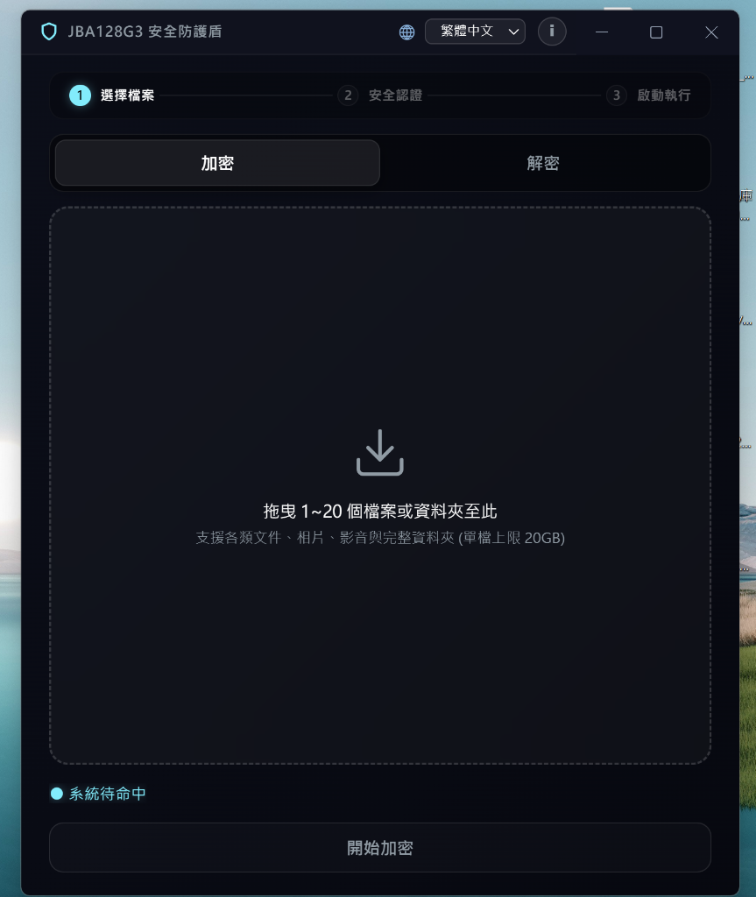

<div align="center">

# 🛡️ Avalon Crypt
### The Sovereign Offline Data Sanctuary in an Insecure Cloud Era
**混亂雲端時代中，你個人核心機密的世外孤島**

[](https://github.com/Mike09182026/TEST/releases/latest)
[-blue?style=for-the-badge&logo=windows)](https://github.com/Mike09182026/TEST/releases)
[](https://mike09182026.github.io/TEST/)
[](#)

<br/>



<br/><br/>

[🌐 官方展示網頁](https://mike09182026.github.io/TEST/) • 
[⚡ 立即下載 (v1.0.3)](https://github.com/Mike09182026/TEST/releases/latest) • 
[☕ 支持獨立研發 (Buy Me a Coffee)](#-support-independent-research--支持獨立研發) • 
🔬 CB_Tec 官方開源庫 (即將公開)

</div>

---

## 🌟 核心設計哲學 / Core Philosophy

在主流軟體皆轉向訂閱制與雲端遙測的今天，**Avalon Crypt** 依然堅持純粹的單機封閉運算。  
底層依託於 **J Will 團隊** 原創之 **CB Tec 後量子空間幾何串流置換架構**，杜絕雲端洩露，為極限個人隱私打造不可侵犯的世外淨土。

* **純地端離線隔離 (Air-Gapped Operation)**：100% 離線封閉運算，無連網通訊組件，遠離網路竊聽。
* **單機零後門 (Zero-Backdoor Sovereign)**：核心無原廠通用主金鑰（Master Key），無原廠後門，金鑰主權 100% 歸使用者掌控。
* **零日誌隱私政策 (Zero-Log Policy)**：全程不向磁碟寫入任何操作歷史或金鑰日誌，磁碟達到 0 Byte 暫存殘留，具備高規格反數位鑑識架構。

---

## 🚀 官方四大核心架構規格 / Core Specifications

| 官方中文名詞 (zh-TW) | 官方英文標準名詞 (English) | 技術定義與架構說明 |
| :--- | :--- | :--- |
| **幾何串流置換演算法** | **Geometric Stream Permutation Cipher** | 自主非 AES 體系之後量子空間幾何置換架構，具備抗量子運算暴力破譯特性。 |
| **常數級記憶體消耗 (防爆)** | **O(1) Constant Memory Chunked Streaming** | 單檔最高支援 20GB。分塊流水線置換機制，記憶體消耗維持常數級，杜絕 OOM 閃退。 |
| **.jbs 專用防護封裝** | **.jbs Secure Encapsulation / Shield Archive** | 專屬安全加密副檔名封裝，支援完整資料夾遞迴加密封裝與目錄結構完整還原。 |
| **雙軌智慧佇列** | **Dual-Track Concurrent Queue** | 智慧識別明文與密文，支援 1~20 任務批次平行運算池，分流青色加密與紫色解密雙軌。 |

---

## 📥 官方發布部署參數 / Deployment Parameters

* **發布版本**：v1.0.3 (Stable Release)
* **目標環境**：Windows 10 / Windows 11 (64-bit)
* **安裝檔名稱**：`JBA128G3_Setup_v1.0.3.exe`
* **檔案大小**：`77,136,168 Bytes`（約 73.5 MB）
* **SHA-256 安全校驗雜湊值**：
  ```text
  EE1AB19B2CF1F7CC2D89730EC05DB96209264B7C862AF6C541AE15294207A1B4
  ```

---

## ☕ Support Independent Research / 支持獨立研發

Avalon Crypt 堅持無廣告、零後門、無資本收購。您的每一份贊助，都是支持我們持續深耕自主密碼學的最大動力！

1. ☕ **Buy Me a Coffee（請喝一杯咖啡 - $5 USD）**：支持單機軟體持續純淨更新。
2. 🚀 **Pioneer Backer（先鋒贊助者 - $29 USD）**：官網永久銘謝名冊、新世代技術白皮書優先閱讀、專屬數位證書。
3. 🏛️ **Code Guardian（開源守護者 - $99+ USD）**：首頁守護者專屬席位、架構師一對一反饋交流通道。

---

## 📜 版權與授權宣告 / License & Attribution

* **版權宣告**：`Avalon Crypt ｜ Powered by J Will Team. All Rights Reserved.`
* **授權邊界**：僅限個人非營利使用 (Personal Non-Commercial License)
* **技術專案生態庫**：[#](#)
